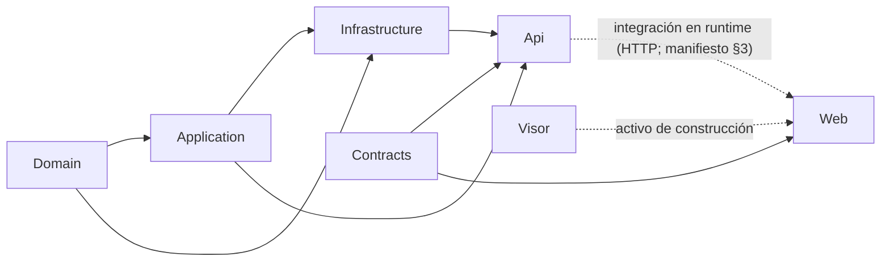

# 04 · Arquitectura: unidades de entrega, proyectos, capas y composición

> **Propósito:** ubicar cómo está armado el producto —dos unidades de entrega, siete proyectos de código, la solución, el grafo de referencias, el orden topológico, la composición de raíz, el arranque en dos fases y el reloj del sistema— y a qué fuente ir para el detalle.
> **Fuente primaria:** `SDD/Intake/PRODUCT-MANIFEST-Fabrica-De-Geometria.md` (§2.A unidades, §2.B proyectos, §2.C matriz de composición, §3 los dos grafos), `GeometriaFactory.sln`, `src/*/*.csproj`, `visor/geometriafactory-visor.csproj`, los `Program.cs` y `src/GeometriaFactory.Api/Composition/`, y `SDD/Docs/Unidades-Entrega/*/05-Arquitectura-Tecnica/`.
> **Revisión indexada:** Lab-Geometria `main` 5f07b12 (PR #234) · ia-db 4.0 · 2026-11-01.
> **No cubre (remite):** rutas HTTP → 06 · almacén y migraciones → 07 · autenticación, límite de tasa, cabeceras, cookie → 08 · pantallas → 09 · visor por dentro → 10 · configuración por entorno → 12 · ADR como decisiones → 15.

---

## 1. Los dos ejes

El producto se describe sobre dos ejes que no coinciden: **unidad de entrega** (lo que se documenta y despliega) y **proyecto de código** (lo que se compila).

| Unidad de entrega | Proyectos de código que agrupa | Proceso desplegable | Documento de arquitectura |
| --- | --- | --- | --- |
| `GeometriaFactory-Api` | Api, Domain, Application, Infrastructure, Contracts | Servicio de datos (HTTP) | `SDD/Docs/Unidades-Entrega/GeometriaFactory-Api/05-Arquitectura-Tecnica/Arquitectura-Unidad-Entrega.md` (línea 10 enumera los cinco) |
| `GeometriaFactory-Web` | Web, Visor, Contracts | Front Blazor (con el bundle del visor embebido) | `SDD/Docs/Unidades-Entrega/GeometriaFactory-Web/05-Arquitectura-Tecnica/Arquitectura-Unidad-Entrega.md` (línea 10 enumera los tres) |

`Contracts` integra las dos unidades: la matriz de composición lo marca en ambas y dice que «alcanza a las dos entregas» (`SDD/Intake/PRODUCT-MANIFEST-Fabrica-De-Geometria.md` §2.C, líneas 167–177). Su arquitectura no tiene documento propio en `05-Arquitectura-Tecnica/`; el de Api lo cita como dependencia en §2.2 (ADR `Contracts ADR-08001`, `ADR-08002` y `ADR-08004`). Fuente: `.../GeometriaFactory-Api/05-Arquitectura-Tecnica/Arquitectura-Unidad-Entrega.md` líneas 86–94.

## 2. Los siete proyectos de código

| Proyecto | Ruta | SDK | Rol | Carpetas principales |
| --- | --- | --- | --- | --- |
| Domain | `src/GeometriaFactory.Domain/` | `Microsoft.NET.Sdk` | Entidades, valores, guardas; centro de la regla de dependencias | `Entities/`, `Values/`, `Guards/` |
| Contracts | `src/GeometriaFactory.Contracts/` | `Microsoft.NET.Sdk` | Tipos de transferencia planos, sin dependencias | `Accounts/`, `Works/`, `Errors/`, `Service/` |
| Application | `src/GeometriaFactory.Application/` | `Microsoft.NET.Sdk` | Casos de uso y puertos | `Accounts/`, `Works/`, `Ports/`, `ApplicationResult.cs` |
| Infrastructure | `src/GeometriaFactory.Infrastructure/` | `Microsoft.NET.Sdk` | Adaptadores de los puertos y mecanismos | `Persistence/`, `Security/`, `Figures/`, `Time/` |
| Api | `src/GeometriaFactory.Api/` | `Microsoft.NET.Sdk.Web` | Host delgado + composición de raíz | `Composition/`, `Endpoints/`, `Program.cs` |
| Web | `src/GeometriaFactory.Web/` | `Microsoft.NET.Sdk.Web` | Front Blazor (render en servidor + circuito interactivo) | `Components/`, `Services/`, `Integration/`, `wwwroot/`, `Program.cs` |
| Visor | `visor/` (`geometriafactory-visor.csproj`) | `Microsoft.Build.NoTargets/3.7.56` | Bundle TypeScript/three.js; sin ensamblado .NET | `src/`, `verification/` |

Paquetes externos relevantes (detalle en 07/08/12):

| Proyecto | Paquetes | Fuente |
| --- | --- | --- |
| Api | `Microsoft.AspNetCore.Authentication.JwtBearer` 10.0.11, `Microsoft.AspNetCore.OpenApi` 10.0.11, `Microsoft.EntityFrameworkCore.Design` 10.0.11, `Scalar.AspNetCore` 2.16.20 | `src/GeometriaFactory.Api/GeometriaFactory.Api.csproj` |
| Infrastructure | `Microsoft.EntityFrameworkCore.Sqlite` 10.0.11, `Microsoft.IdentityModel.JsonWebTokens` 8.22.0, `Microsoft.EntityFrameworkCore.Design` 10.0.11 | `src/GeometriaFactory.Infrastructure/GeometriaFactory.Infrastructure.csproj` |
| Domain, Contracts, Application, Web | sin `PackageReference` | sus `.csproj` |

## 3. La solución y su árbol

Fuente: `GeometriaFactory.sln` (entradas `Project(...)` y `NestedProjects`). El árbol mezcla dos vistas: `src/` y `tests/` son carpetas de disco (esos proyectos cuelgan de la raíz del .sln, no de una carpeta de solución); `visor` y `samples` sí son carpetas de solución.

```
GeometriaFactory.sln
├── src/ (disco; raíz del .sln)            6 proyectos .NET de producto (el 7.º, el visor, está en visor/)
│   ├── GeometriaFactory.Domain
│   ├── GeometriaFactory.Contracts
│   ├── GeometriaFactory.Application
│   ├── GeometriaFactory.Infrastructure
│   ├── GeometriaFactory.Api
│   └── GeometriaFactory.Web
├── visor/ (carpeta de solución)
│   └── geometriafactory-visor             visor/geometriafactory-visor.csproj (NoTargets)
├── tests/ (disco; raíz del .sln)          4 baterías (detalle → 11)
│   ├── GeometriaFactory.Domain.Tests
│   ├── GeometriaFactory.Application.Tests
│   ├── GeometriaFactory.Integration.Tests
│   └── GeometriaFactory.E2ETests
└── samples/ (carpeta de solución)         20 samples en 7 subcarpetas (detalle → 13)
    ├── domain/         01-basico, 02-intermedio, 03-avanzado
    ├── application/    01-basico, 02-intermedio, 03-avanzado
    ├── infrastructure/ 01-basico, 02-intermedio, 03-avanzado
    ├── contracts/      01-basico, 02-intermedio, 03-avanzado      (NoTargets)
    ├── api/            01..03 + 04-cliente-http-basico            (NoTargets)
    ├── visor/          01-basico, 02-intermedio, 03-avanzado      (NoTargets)
    └── web/            01-datos-seed                              (NoTargets)
```

Que todos los samples estén en la solución lo exige una puerta transversal (árbol de solución) → 11.

## 4. Grafo de `ProjectReference`

Medido sobre los `.csproj` versionados en 5f07b12.

| Proyecto | Referencia a | Fuente |
| --- | --- | --- |
| Domain | — | `src/GeometriaFactory.Domain/GeometriaFactory.Domain.csproj` |
| Contracts | — | `src/GeometriaFactory.Contracts/GeometriaFactory.Contracts.csproj` |
| Application | Domain | `src/GeometriaFactory.Application/GeometriaFactory.Application.csproj` |
| Infrastructure | Domain, Application | `src/GeometriaFactory.Infrastructure/GeometriaFactory.Infrastructure.csproj` |
| Api | Application, Infrastructure, Contracts | `src/GeometriaFactory.Api/GeometriaFactory.Api.csproj` |
| Web | Contracts | `src/GeometriaFactory.Web/GeometriaFactory.Web.csproj` |
| Visor | — (ni hacia ni desde) | `visor/geometriafactory-visor.csproj` (comentario de cabecera) |



(Flecha = «es usado por».) Observaciones de estructura:

- **Api no referencia Domain directamente**: lo alcanza transitivamente por Application/Infrastructure. Fuente: `src/GeometriaFactory.Api/GeometriaFactory.Api.csproj`.
- **Web no referencia Api**: lo alcanza por HTTP con `DataServiceClient` (→ 09). Fuente: `.../GeometriaFactory-Api/05-Arquitectura-Tecnica/Arquitectura-Unidad-Entrega.md` línea 86.
- Referencias desde pruebas y samples:

| Consumidor | Referencia a |
| --- | --- |
| `tests/GeometriaFactory.Domain.Tests` | Domain |
| `tests/GeometriaFactory.Application.Tests` | Application |
| `tests/GeometriaFactory.Integration.Tests` | Api, Contracts, Web |
| `tests/GeometriaFactory.E2ETests` | ninguno (Playwright contra el producto levantado; → 11) |
| `samples/domain/*` | Domain |
| `samples/application/*` | Application |
| `samples/infrastructure/*` | Infrastructure |
| `samples/{api,contracts,visor,web}/*` | ninguno (`NoTargets`, sin `ProjectReference`) |

### 4.1 Arista `Visor → Web`: activo de construcción, no referencia

Fuente: `visor/geometriafactory-visor.csproj` y `src/GeometriaFactory.Web/GeometriaFactory.Web.csproj` (comentarios y targets).

| Pieza | Qué hace | Dónde |
| --- | --- | --- |
| `geometriafactory-visor.csproj` | Nodo `NoTargets` para que el visor figure en la solución; `EnableDefaultItems=false` para no arrastrar `node_modules/` | `visor/geometriafactory-visor.csproj` |
| Target `BuildVisor` | Corre `scripts/build-visor.sh` antes de `BeforeBuild`, incremental por `Inputs` (`visor/src/**/*.ts`, `package-lock.json`, `webpack.config.js`, `tsconfig.json`) / `Outputs` (`wwwroot/js/geometriafactory-visor.js`); se apaga con `-p:SkipVisorBuild=true` | `src/GeometriaFactory.Web/GeometriaFactory.Web.csproj` |
| Target `DeclareVisorAsset` | Declara el bundle (y su `.map`) como `Content` antes de `ResolveProjectStaticWebAssets` | ídem |
| Target `SealVisorAsset` | Genera `VisorSeal.g.cs` con los 12 primeros hex del SHA-256 del bundle (o `sin-bundle`); las páginas lo usan como `?v=<sello>` | ídem |
| Historia | Hasta 2026-09-12 la arista la materializaba sólo el guion invocado a mano; ahora la expresa el `.csproj` (ADR `Web ADR-10008` → 15) | comentario en `GeometriaFactory.Web.csproj` |

El bundle por dentro y `build-visor.sh` → 10.

## 5. Orden topológico

| Nivel | Proyectos | Fuente |
| --- | --- | --- |
| 0 | Domain, Contracts, Visor | `SDD/Intake/PRODUCT-MANIFEST-Fabrica-De-Geometria.md` §3, líneas 216–218 |
| 1 | Application, Web | ídem |
| 2 | Infrastructure | ídem |
| 3 | Api | ídem |

El roadmap declara que la etapa `a` construyó los siete proyectos en esqueleto respetando este orden y que cada etapa posterior agregó comportamiento (`SDD/Docs/00-Contexto/Roadmap-Producto.md` línea 68, que cita PRODUCT-INTAKE §15). Etapas → 03.

El manifiesto declara «cuatro niveles en `GeometriaFactory.sln`» (§4, línea 245), y el documento de arquitectura de Api los cita en §2.2 Domain («nivel 0 del orden topológico del `PRODUCT-MANIFEST` §3», línea 104), §2.3 Application («nivel 1», línea 129) y «Qué hereda de los niveles 0 y 1» (línea 178) (`.../GeometriaFactory-Api/05-Arquitectura-Tecnica/Arquitectura-Unidad-Entrega.md`).

**Grafo de integración** (ordena la generación de la documentación, no el build): nivel 0 `GeometriaFactory-Api`, nivel 1 `GeometriaFactory-Web`; una sola arista, de **runtime** (el front habla con la API por HTTP). Fuente: `SDD/Intake/PRODUCT-MANIFEST-Fabrica-De-Geometria.md` §3, líneas 188–196.

**Clases de arista del grafo de compilación**: ocho aristas, siete **referencias de proyecto** que materializa un `.csproj` y un **insumo de construcción** (`Visor → Web`, el bundle generado por el target `BuildVisor` de `GeometriaFactory.Web.csproj`). Fuente: `SDD/Intake/PRODUCT-MANIFEST-Fabrica-De-Geometria.md` §3, líneas 199–214.

## 6. Arquitectura de la unidad `GeometriaFactory-Api`

Fuente: `SDD/Docs/Unidades-Entrega/GeometriaFactory-Api/05-Arquitectura-Tecnica/Arquitectura-Unidad-Entrega.md` (1269 líneas; secciones 1–11 repetidas por proyecto: 1.1 Api, 1.2 Domain, 1.3 Application, 1.4 Infrastructure).

### 6.1 Estilo por proyecto

| Proyecto | Estilo (resumen) | Sección | ADR (→ 15) |
| --- | --- | --- | --- |
| Api | **Host delgado sobre una composición de raíz única**: puntos sin lógica de negocio; una sola composición; guardia transversal; dos traducciones (motivo→código de contrato→código HTTP); formato de intercambio fijado acá; arranque en dos fases | §2.1 | `ADR-00001`, `00002`, `00003`, `00004`, `00006`, `00007` |
| Domain | Núcleo sin dependencias; estilos distribuidos no evaluados | §2.2 | ver documento |
| Application | Casos de uso sobre puertos; hereda la arquitectura de dominio | §2.3 | ver documento |
| Infrastructure | Adaptadores de los cuatro puertos + dos mecanismos + responsabilidad de arranque | §2.4 | ver documento |

### 6.2 Mapa de vistas (dónde está cada cosa)

| Vista | Sección | Contenido indexable |
| --- | --- | --- |
| Lógica | §3.1–§3.4 | Componentes, regla de dependencias interna, cobertura de casos de uso (Api 12, Domain 13, Application 11, Infrastructure 10), los 15 puntos contra su componente (Api §3.1.4), los cuatro puertos como frontera (Application §3.3.4) |
| Procesos | §4 | por proyecto |
| Despliegue | §5 | por proyecto (imágenes → 12) |
| Datos | §6 | por proyecto (almacén → 07) |
| Transversales | §7 | por proyecto |
| Atributos de calidad (NFR) | §8 | por proyecto |
| Riesgos | §9 | incluye §9.1.1 «CORS: por qué no aplica hoy» (→ 08) |
| Trazabilidad | §10 | componente↔CU, 16 reglas, 9 invariantes, 3 reglas RA, 8 escenarios contra la batería del validador |
| Puntos abiertos | §11 | por proyecto (consolidado → 03) |
| Control de cambios | §12 | — |

### 6.3 Código de la unidad, por capa

| Capa | Archivos | Fuente |
| --- | --- | --- |
| Api · Composition | `CompositionRoot.cs` (231), `TwoPhaseStartup.cs` (36), `ApiDocumentation.cs`, `ContractErrorHandler.cs`, `ContractRateLimiting.cs`, `CredentialAttemptThrottle.cs`, `SecurityHeaders.cs` | `src/GeometriaFactory.Api/Composition/` |
| Api · Endpoints | `AuthenticationEndpoints`, `AccountEndpoints`, `CommissionAccountEndpoints`, `WorkEndpoints`, `HealthEndpoint`, `ContractRoutePrefix`, `ContractTranslation`, `PendingPasswordChangeGuard` | `src/GeometriaFactory.Api/Endpoints/` (→ 06) |
| Application · Accounts | 6 casos de uso (`ConfigureAdministrator`, `ResolveSignIn`, `ChangeOwnPassword`, `RegisterAccount`, `GovernCommissionAccounts`, `ResetStudentPassword`) + `RegistrationPolicy` y tipos de resultado | `src/GeometriaFactory.Application/Accounts/` (→ 05) |
| Application · Works | 5 casos de uso (`LoadAndEditOwnWork`, `ConsultOwnWorks`, `ReviewCommissionWorks`, `DeleteWork`, `ResolveWork`) + vistas | `src/GeometriaFactory.Application/Works/` (→ 05) |
| Application · Ports | `IAccountRepository`, `IWorkRepository`, `IFigureValidator`, `ISystemClock`, `FigureInterpretation`, `TextNode` | `src/GeometriaFactory.Application/Ports/` |
| Infrastructure | `Persistence/` (→ 07), `Security/` (→ 08), `Figures/LocalFigureValidator.cs` (→ 05), `Time/UtcSystemClock.cs` (§10) | `src/GeometriaFactory.Infrastructure/` |
| Domain | `Entities/` (5), `Values/` (10), `Guards/` (2) | `src/GeometriaFactory.Domain/` (→ 05) |

## 7. Arquitectura de la unidad `GeometriaFactory-Web`

Fuente: `SDD/Docs/Unidades-Entrega/GeometriaFactory-Web/05-Arquitectura-Tecnica/Arquitectura-Unidad-Entrega.md` (637 líneas; secciones repetidas para 1.1 Web y 1.2 Visor).

### 7.1 Estilo de Web (§2.1)

**Monolito de presentación con render en el servidor y circuito interactivo, en tres capas internas, con un cliente tipado como única salida hacia el servicio de datos.** Cinco propiedades:

| # | Propiedad | ADR (→ 15) |
| --- | --- | --- |
| 1 | La llamada al servicio de datos la hace el servidor del front, no el navegador (`RA-01`) | `ADR-10001` |
| 2 | Sin estado propio ni persistencia; sin servicio → estado degradado | `ADR-10002` |
| 3 | La credencial de sesión vive del lado del servidor y no llega al navegador | `ADR-10003` |
| 4 | Tres capas con dependencias unidireccionales: superficies → servicios de front → salidas (cliente tipado e interop con la fachada del visor) | `ADR-10004` |
| 5 | El bundle del visor se opera sólo por sus seis funciones | `ADR-10006` |

### 7.2 Estilo del Visor (§2.2) y mapa de vistas

| Tema | Sección |
| --- | --- |
| Estilo del visor, alternativas, nota de vocabulario | §2.2 |
| Componentes de Web, cobertura de 10 CU, 11 superficies contra componente | §3.1 |
| Componentes del visor, cobertura de 7 CU, qué se porta | §3.2 |
| Procesos / despliegue / datos / transversales / NFR / riesgos | §4–§9 |
| Trazabilidad: 13 restricciones transversales, 16 reglas, 3 RA; 7 garantías del visor | §10 |
| Puntos abiertos | §11 |

### 7.3 Código de Web, por capa (ubicación; contenido → 08/09)

| Capa (ADR-10004) | Ubicación |
| --- | --- |
| Superficies | `src/GeometriaFactory.Web/Components/{Pages,Layout,Shared,Work}/`, `App.razor`, `Routes.razor` |
| Servicios de front | `src/GeometriaFactory.Web/Services/` (15 archivos) |
| Salidas | `src/GeometriaFactory.Web/Integration/` (`DataServiceClient`, `DataServiceOutcome`, `BrowserOriginForwardingHandler`, `SecurityHeaders`) e interop con `wwwroot/js/geometriafactory-visor.js` |

## 8. Flujo de ejecución

Los dos documentos `Flujo-Ejecucion.md` no describen el flujo de una petición sino el de un componente concreto:

| Documento | Título real | Qué describe | Remite |
| --- | --- | --- | --- |
| `SDD/Docs/Unidades-Entrega/GeometriaFactory-Api/05-Arquitectura-Tecnica/Flujo-Ejecucion.md` (143) | «Flujo de ejecución del validador de figuras — GeometriaFactory-Infrastructure» | Pipeline P-1..P-7 (admitir → leer con tolerancia T2 → contar raíz → reconstruir piezas T1/T3 → componentes → derivar y comparar, tolerancia 0.01 → reunir), tres terminaciones, tabla de derivación | contenido → 05 |
| `SDD/Docs/Unidades-Entrega/GeometriaFactory-Web/05-Arquitectura-Tecnica/Flujo-Ejecucion.md` (138) | «Flujo de ejecución — GeometriaFactory-Visor» | Ciclo de vida de instancia, canalización de dibujo, bucle, liberación | contenido → 10 |

El flujo de una petición HTTP se lee en el orden de la tubería de cada `Program.cs` (§11).

## 9. Abstracciones y puertos

### 9.1 Los cuatro puertos y su adaptador

Fuente: `src/GeometriaFactory.Api/Composition/CompositionRoot.cs` (`DeclaredPorts`, `ConnectedPorts`, líneas 35–61).

| Puerto (Application/Ports) | Adaptador (Infrastructure) | Ciclo de vida | Detalle |
| --- | --- | --- | --- |
| `IAccountRepository` | `Persistence/EfCoreAccountRepository` | Scoped | → 07 |
| `IWorkRepository` | `Persistence/EfCoreWorkRepository` | Scoped | → 07 |
| `IFigureValidator` | `Figures/LocalFigureValidator` | Singleton | → 05 |
| `ISystemClock` | `Time/UtcSystemClock` | Singleton | §10 |

El cuadre declarados = conectados es la puerta `QG-10`; se cerró en la etapa `f` (comentario de `ConnectedPorts`). Puerta → 11.

### 9.2 Documentos de contratos y abstracciones

| Documento | Cubre | Secciones clave |
| --- | --- | --- |
| `SDD/Docs/Unidades-Entrega/GeometriaFactory-Api/05-Arquitectura-Tecnica/Contratos-Abstractions.md` (396) | Api, Application, Infrastructure | §3.2 los cuatro adaptadores, los dos mecanismos, la responsabilidad de arranque; §8 operaciones (cara de arriba de Application); §9 puertos (cara de abajo); §10 cuatro comprobaciones por operación; §11 esquemas que cruzan cada frontera |
| `SDD/Docs/Unidades-Entrega/GeometriaFactory-Web/05-Arquitectura-Tecnica/Contratos-Abstractions.md` (162) | Superficie pública del Visor | seis funciones, esquemas, conjuntos cerrados, errores, versionado (contenido → 10) |

## 10. Reloj del sistema (CU-06009)

| Elemento | Detalle | Fuente |
| --- | --- | --- |
| Puerto | `ISystemClock { DateTimeOffset UtcNow { get; } }`, único miembro; declarado por intake §13, §14 y §17.2.P.11 punto 3 | `src/GeometriaFactory.Application/Ports/ISystemClock.cs` |
| Adaptador | `UtcSystemClock` → `DateTimeOffset.UtcNow`; único adaptador; llegó en la etapa `c` (`Infrastructure BT-12`) | `src/GeometriaFactory.Infrastructure/Time/UtcSystemClock.cs` |
| Registro | `AddSingleton<ISystemClock, UtcSystemClock>()` | `src/GeometriaFactory.Api/Composition/CompositionRoot.cs` línea 138 |
| Propósito | Sello de alta, modificación y desenlace; existe como puerto para que los sellos sean verificables en prueba | `.../Operaciones-Internas/CU-06009-Proveer-El-Sello-Del-Reloj-Del-Sistema.md` §1; «el doble de prueba reemplaza a este adaptador y a nadie más»: comentario de `src/GeometriaFactory.Infrastructure/Time/UtcSystemClock.cs` línea 11 |
| Lo que no hace | No interpreta ni guarda el sello; no se mezcla con la `Fecha` declarada por el alumno | ídem §1 |
| Regla | Siempre UTC (`RC-06`, `Modelo-Datos-Logico.md` §2.1) | comentario de `ISystemClock.cs` |

> Divergencia menor: el comentario de `UtcSystemClock.cs` lo rotula «CU-09», numeración previa a la renumeración a `CU-06009` (→ 17 / 19).

El front usa otro reloj: `TimeProvider.System` registrado en `src/GeometriaFactory.Web/Program.cs` línea 170 (no es el puerto).

## 11. Composición de raíz (CU-00010)

### 11.1 Qué declara el caso de uso

Fuente: `SDD/Docs/Unidades-Entrega/GeometriaFactory-Api/05-Arquitectura-Tecnica/Operaciones-Internas/CU-00010-Componer-La-Aplicacion-Y-Conectar-Los-Puertos-Con-Sus-Adaptadores.md` (§1, §4).

| Paso | Qué |
| --- | --- |
| 1 | Conectar los cuatro puertos con sus adaptadores |
| 2 | Conectar los dos mecanismos que no son puertos: credenciales y acceso firmado |
| 3 | Tomar de configuración la ubicación del almacén (en producción, volumen; nunca dentro de la imagen) |
| 4 | Tomar de configuración la clave de firma (variable de entorno o archivo montado) |
| 5 | Conectar los casos de uso de Application |
| 6 | Pasar al arranque (CU-00011) |

No es un punto de acceso ni traza a necesidad de negocio («conectar un puerto con su adaptador es construcción y no capacidad»). Ningún secreto entra al repositorio. La unidad de trabajo la declara cada caso de uso; la composición no abre ni comparte ninguna.

### 11.2 Cómo lo implementa el código

Fuente: `src/GeometriaFactory.Api/Composition/CompositionRoot.cs` (`AddCompositionRoot`, línea 65).

| Bloque | Registros | Líneas |
| --- | --- | --- |
| Almacén | `AddDbContext<GeometriaFactoryDbContext>` (SQLite, cadena `Store`), `StorePreparation`, `StoreHealth` (scoped), `TwoPhaseStartup` (singleton) | 125–130 |
| Puertos | ver §9.1 | 137–144 |
| Mecanismos de seguridad | firma, `PasswordDerivation`, `AccessTokenIssuer`, `ProvisionalPasswordFactory` (singleton) | 181–189 (→ 08) |
| Casos de uso de cuentas | 6 casos de uso + `RegistrationPolicy` | 192–203 |
| Casos de uso de trabajos | 5 casos de uso (scoped) | 208–214 |
| Autenticación/autorización | `AddAuthentication(JwtBearer)`, `AddAuthorization` | 220–227 (→ 08) |

Constante: `StoreConnectionName = "Store"` (valor por configuración, → 12).

## 12. Arranque en dos fases (CU-00011)

| Elemento | Detalle | Fuente |
| --- | --- | --- |
| Caso de uso | Disparar la preparación del almacén antes de la primera petición y exponer A-16 (salud, sin acceso firmado) | `.../Operaciones-Internas/CU-00011-Arrancar-El-Servicio-Y-Dejar-El-Almacen-En-Condiciones.md` §1, §4 |
| Terminación propia | **Arranque detenido**: si el almacén no queda en condiciones, no se atiende ninguna petición | ídem §1 |
| Clase | `TwoPhaseStartup.PrepareStoreAsync` crea un scope, ejecuta `StorePreparation.PrepareAsync` y publica `StoreIsPrepared` (dato que lee el punto de salud) | `src/GeometriaFactory.Api/Composition/TwoPhaseStartup.cs` |
| Fase 1 | Antes de abrir HTTP; omitida si `EF.IsDesignTime` (para que `scripts/migrate.sh` genere migraciones sin aplicarlas) | `src/GeometriaFactory.Api/Program.cs` |
| Fallo | Atrapa `InvalidOperationException`, registra la traza por logging, escribe la causa y la indicación al operador en stderr y termina con **código 78** (`EX_CONFIG`) en vez de dejar escapar la excepción (cambio del 2026-08-30) | `src/GeometriaFactory.Api/Program.cs` |
| Fase 2 | Recién entonces arma la tubería y `RunAsync` | ídem |
| Puertas y ADR | `QG-11` (cero peticiones con preparación incompleta), `US-27`/`US-28`; `Api ADR-00007` | comentarios de `TwoPhaseStartup.cs` y `Program.cs` |

Preparación del almacén por dentro (CU-06010) → 07.

## 13. Los `Program.cs`

### 13.1 Api — `src/GeometriaFactory.Api/Program.cs` (134 líneas)

Host delgado: la composición vive en `Composition/` (`Api ADR-06` y `ADR-07` según su comentario de cabecera).

| Orden | Paso | Remite |
| --- | --- | --- |
| Servicios | `AddCompositionRoot`, `AddContractRateLimiting`, `AddApiDocumentation`, `AddExceptionHandler<ContractErrorHandler>` | §11 · 08 · 06 |
| Fase 1 | `TwoPhaseStartup` (§12) | 07 |
| Tubería 1 | `UseExceptionHandler` (primero, para atrapar fallos de enlace) | 06 |
| 2 | `UseForwardedHeaders` (antes de todo lo que mire la dirección de origen) | 08 |
| 3 | `UseSecurityHeaders` | 08 |
| 4 | `UseRouting` → `UseAuthentication` | 08 |
| 5 | `UseRateLimiter` (después de autenticar, antes de autorizar) | 08 |
| 6 | `UseAuthorization` → `PendingPasswordChangeGuard` | 08 · 06 |
| Mapeo | `MapApiDocumentation`; `MapHealthEndpoint` fuera del prefijo; grupo `ContractRoutePrefix.Value` (`/v1`) con límite de tasa y los cuatro grupos de puntos | 06 |
| Visibilidad | `public partial class Program` para que `Integration.Tests` levante la aplicación real en memoria | 11 |

### 13.2 Web — `src/GeometriaFactory.Web/Program.cs` (282 líneas)

| Orden | Paso | Líneas | Remite |
| --- | --- | --- | --- |
| Primero | `StartupObservations` + proveedor de logging (escuchar el marco desde el arranque; mesa 2026-09-01-C, `AB-2`) | 16–17 | 09 |
| Servicios | `AddRazorComponents().AddInteractiveServerComponents()` | 19 | 09 |
| | `AddDataProtection` persistente, `DataProtectionState` | 82–105 | 08 |
| | Autenticación por cookie, `SessionTokenStore`, `PendingCredentialChangeStore`, `ProvisioningStateProbe` | 110–158 | 08 |
| | `VersionIdentity`, `TimeProvider.System`, `DataServiceReachability`, `HttpContextAccessor` | 163–173 | 09 · 12 |
| | `ForwardedHeadersOptions`, `BrowserOriginForwardingHandler`, `SessionState`, `AddHttpClient<DataServiceClient>` | 180–208 | 08 · 09 |
| Tubería | `UseForwardedHeaders` → `UseSecurityHeaders` → `UseStatusCodePagesWithReExecute("/no-encontrado")` → `UseStaticFiles` → `UseRouting` | 229–237 | 08 · 09 |
| | `ProvisioningGateMiddleware` → `UseAuthentication`/`UseAuthorization` → `UnrestorableSessionMiddleware` → `PanelSessionGateMiddleware` → `StaleFormMiddleware` → `UseAntiforgery` | 255–277 | 08 · 09 |
| Mapeo | `MapRazorComponents<App>().AddInteractiveServerRenderMode()` | 279–280 | 09 |

El front **no** tiene arranque en dos fases: no tiene almacén (ADR-10002).

### 13.3 Raíz de componentes del front

| Archivo | Rol | Fuente |
| --- | --- | --- |
| `App.razor` | Documento HTML raíz: `HeadOutlet`, `<Routes />`, `interaction/surface-interaction.js`, `_framework/blazor.web.js` | `src/GeometriaFactory.Web/App.razor` |
| `Routes.razor` | `Router` con `DefaultLayout = AccessShell` (el shell de acceso es el default deliberado: el error barato), `FocusOnNavigate` a `h1`, `NotFound` sólo para el render interactivo; el comentario mapea SUP-01..SUP-11 a rutas | `src/GeometriaFactory.Web/Routes.razor` (detalle de rutas → 09) |

## 14. Extensibilidad

| Unidad | Punto de extensión | Fuente |
| --- | --- | --- |
| Web/Visor | **El contrato de la fachada del visor** (seis funciones: `inicializar`, `cargarJson`, `seleccionarPieza`, `redimensionar`, `destruir`, `establecerMovimiento`) es el punto de extensión del producto (intake §18); permite reemplazar el motor 3D sin tocar páginas; lo ejerce el sample S-1 sin backend | `SDD/Docs/Unidades-Entrega/GeometriaFactory-Web/05-Arquitectura-Tecnica/Extensibilidad.md` §2 |
| | Reemplazable: motor 3D, capa 3 entera, forma interna del identificador. No reemplazable: disposición (derivada del índice, G-6), las seis funciones, las siete garantías, los siete códigos de condición | ídem §3 |
| | Contrato de un reemplazo, crecimiento de la fachada, ejemplo, lo que no es extensión | ídem §4–§7 |
| Api | Sin documento `Extensibilidad.md` en su `05-Arquitectura-Tecnica/`; la sustitución de adaptadores se apoya en los puertos (§9) | listado de `SDD/Docs/Unidades-Entrega/GeometriaFactory-Api/05-Arquitectura-Tecnica/` |

Documentos de extensibilidad de calidad (→ 11). ADR 12001/12002/12004/12005/12006 → 15.

## 15. Dónde seguir

| Necesitás… | Índice |
| --- | --- |
| Rutas `/v1`, tipos de Contracts, errores | 06 |
| Entidades, casos de uso, validador | 05 |
| DbContext, migraciones, preparación del almacén | 07 |
| JWT, cookie, límite de tasa, cabeceras | 08 |
| Pantallas, layouts, `DataServiceClient` | 09 |
| Fachada y bundle del visor | 10 |
| `QG-10`, `QG-11`, puerta de árbol de solución | 11 |
| `Directory.Build.props`, appsettings, imágenes | 12 |
| Samples | 13 |
| ADR | 15 |
